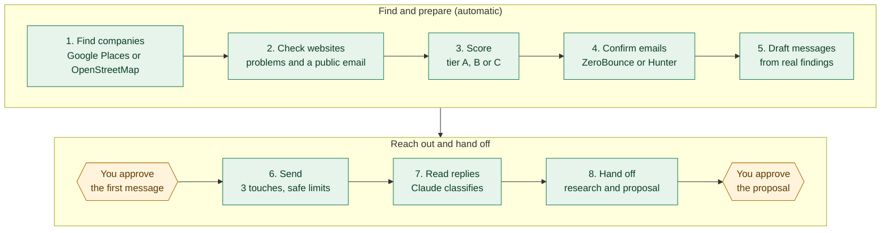
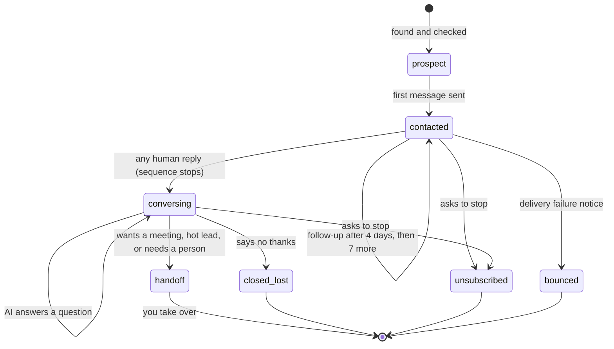
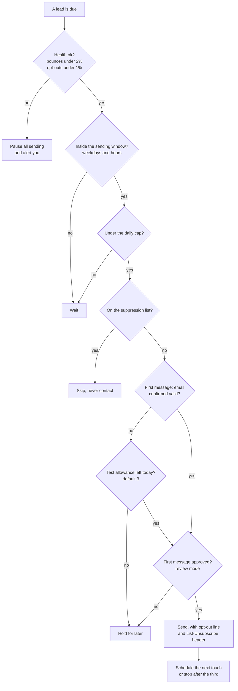
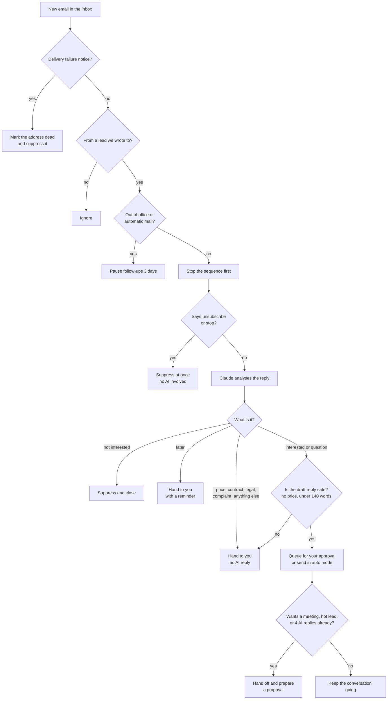
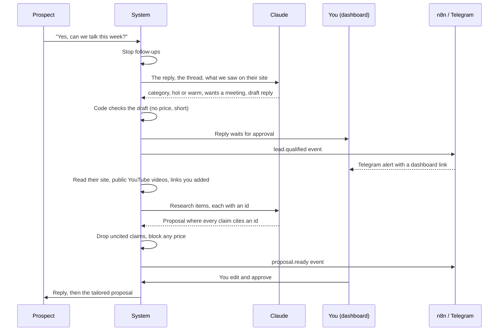
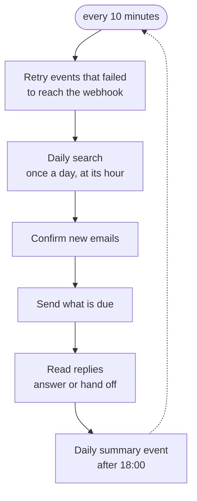
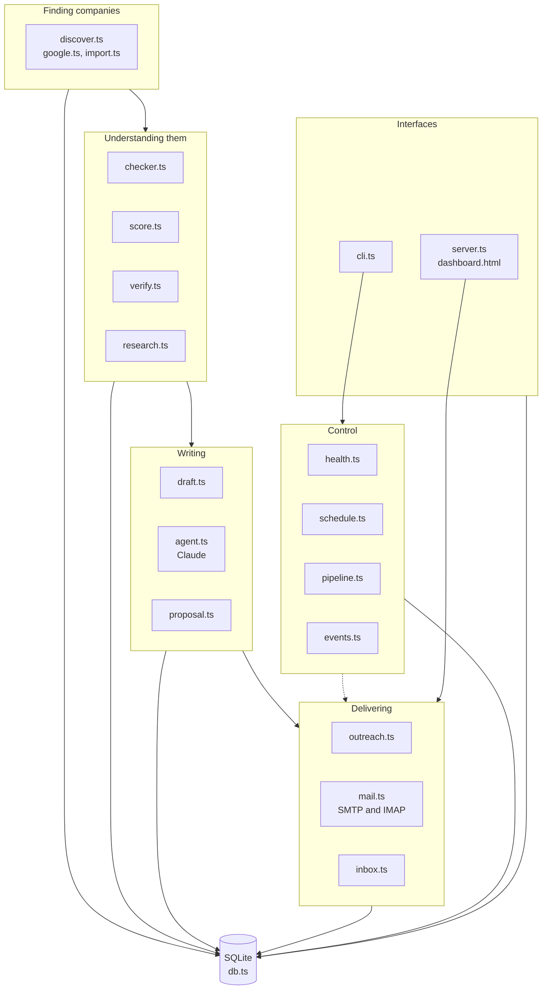
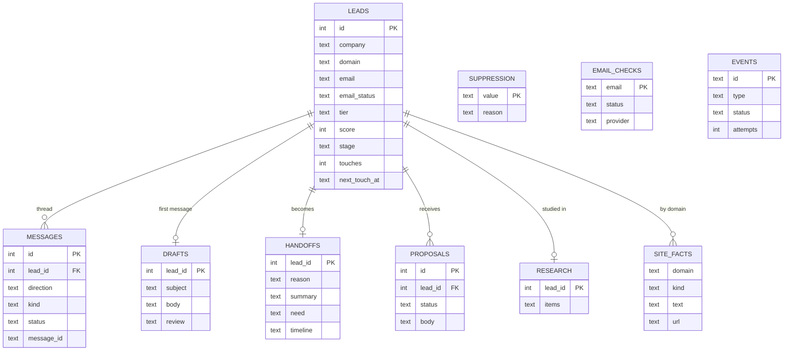

# gulf-leads

[العربية](README.ar.md)

An outbound sales assistant for people who sell to businesses in the Gulf. It **finds companies, studies their websites, writes messages from what it really found, sends them safely, reads the replies, talks to interested people, and hands you the ones worth a call, together with a tailored proposal.**

Everything that commits you to something (a first message, an AI reply, a proposal) waits for your approval in the dashboard until you decide to let it run on its own.

> **Status, honestly.** The logic is covered by 52 automated tests that use fake mailboxes, fake APIs and a real local receiver. It has **not** yet been run against a real mailbox, the real Claude API, Google Places, ZeroBounce/Hunter, YouTube or a real n8n. Treat the first weeks as a supervised trial: stay in `review` mode and read what it does.


## Contents

1. [The idea in one picture](#the-idea-in-one-picture)
2. [What happens to a company](#what-happens-to-a-company)
3. [Before anything is sent](#before-anything-is-sent)
4. [When someone replies](#when-someone-replies)
5. [From "interested" to a proposal](#from-interested-to-a-proposal)
6. [The automation loop](#the-automation-loop)
7. [Scoring](#scoring)
8. [The dashboard](#the-dashboard)
9. [n8n and webhooks](#n8n-and-webhooks)
10. [How the code is organised](#how-the-code-is-organised)
11. [The data model](#the-data-model)
12. [Safety rules, and the tests that prove them](#safety-rules-and-the-tests-that-prove-them)
13. [Setup](#setup)
14. [Configuration reference](#configuration-reference)
15. [Commands](#commands)
16. [What is not built, and legal notes](#what-is-not-built-and-legal-notes)

## The idea in one picture

Green steps run by themselves. Amber steps wait for you.



The thing that makes the messages worth reading: step 2 looks at each company's real website (no online booking, not built for phones, slow, no WhatsApp button, outdated footer, no HTTPS) and step 5 only writes about what was actually seen, with the link and date kept as evidence. A message with nothing real to say becomes a plain, honest segment-level note instead of an invented compliment.

## What happens to a company

Every company has a `stage`. The system only moves it forward through the paths below.



`unsubscribed`, `closed_lost` and `bounced` are final: the address goes on the suppression list and is never written to again, by any tool or channel.

## Before anything is sent

`sendDue` in [`src/outreach.ts`](src/outreach.ts) runs every cycle. A message goes out only if it passes every gate below.



Follow-ups (touch 2 and 3) are short fixed templates, not AI text. Touch 1 is the drafted message. There is never a fourth touch.

## When someone replies

`processInbox` in [`src/inbox.ts`](src/inbox.ts) reads the mailbox. **Code makes every decision; Claude only fills in a form** (category, how ready the person is, what they need, a draft reply).



What the AI is told: it is an assistant (never a human, and it says so if asked); it may only state the facts you wrote in `qualification.facts`; it never mentions a price; replies are 40 to 90 words in the language the person used; the incoming email is treated as untrusted data and cannot change its instructions. Every AI reply is signed with the assistant's name.

## From "interested" to a proposal



It only reads the company's own website and its public YouTube channel (through the official API). Instagram, TikTok, LinkedIn and Facebook are not read automatically, because their terms forbid it; a link you paste from them is noted as "not fetched". A proposal never contains a price, and it **always** needs your approval, even in `auto` mode.

## The automation loop

`npm run leads -- loop` runs one cycle every 10 minutes. All state lives in SQLite, so you can stop and start it freely.



The daily search (`schedule.discover` in your profile) does steps 1 to 5 of the first diagram by itself, with a cap on companies per day, then sends you a `discovery.done` event.

## Scoring

```
priority = fit (0-40) + intent (0-40) + relationship (0-20) - risk
```

| Part | What adds points |
|---|---|
| Fit | country in your list +10, industry in your list +10, size in range +10 (+5 if unknown), website reachable +10 |
| Intent | what the website lacks: no online booking 12, not mobile-ready 10, slow 8, no HTTPS 8, old footer 7, no WhatsApp or chat 5 (capped at 40) |
| Relationship | an email that is not invalid +10, a decision-maker title +10 |
| Risk | no email -25, invalid email -40, unconfirmed or catch-all -5 |

Tier A is 70 or more, B is 45 or more, everything else is C. Only A and B are written to. A suppressed or unreachable company scores -100.

## The dashboard

`npm run leads -- dashboard` serves a local page (`localhost:4300`, never exposed to the network) with a sign-in link in the terminal. Light and dark themes, works on a phone.

| Page | What it is for |
|---|---|
| Overview | KPIs with sparklines, daily activity chart, sending health, the funnel, tier and email donuts, the problems found on client sites, sectors |
| Needs your approval | first messages, AI replies and proposals, each editable before you approve |
| Ready to call | people who showed real interest, with the AI's summary |
| All leads | search, filter, open any conversation, stop contact for good |
| Integrations | webhook status, test button, daily search schedule, event log, the n8n workflow download |


## n8n and webhooks

Important events are POSTed to `WEBHOOK_URL` (n8n, Make, Zapier or your own server). Each request carries `x-gulf-secret` and `x-gulf-signature` (`sha256=` HMAC of the body). `http` is accepted only for your own machine or network; anything on the internet must be `https`. A broken receiver never stops the pipeline: failures are logged and retried, up to six attempts in 24 hours.

| Event | When |
|---|---|
| `lead.qualified` | someone asked for a call, or is clearly ready |
| `lead.needs_human` | a price question, complaint, "later", or the AI could not decide |
| `proposal.ready` | a tailored proposal is waiting for approval |
| `reply.pending` | an AI reply is waiting for approval |
| `sending.paused` | bounces or opt-outs passed the limit |
| `lead.unsubscribed`, `lead.bounced` | someone left, or an address died (no email address in the payload) |
| `discovery.done` | the daily search finished |
| `daily.summary` | once a day |

Import [`integrations/n8n/gulf-leads.workflow.json`](integrations/n8n/gulf-leads.workflow.json) (Webhook, then a message, then Telegram). Create a Header Auth credential named `x-gulf-secret` with the same value as `WEBHOOK_SECRET`, put the production URL in `WEBHOOK_URL`, and run `npm run leads -- webhook-test`.

n8n can call back when `HOOK_TOKEN` is set (header `x-hook-token`): `POST /api/hooks/discover` to start a search and `POST /api/hooks/suppress` to block someone. It can **never** approve or send a message.

## How the code is organised

Plain TypeScript run directly by Node 24 (no build step), SQLite through `node:sqlite`, no framework.



| File | Job |
|---|---|
| `discover.ts`, `google.ts` | search OpenStreetMap or Google Places by country, city and industry |
| `checker.ts` | open a site, record what is missing, find a public email |
| `score.ts` | the formula above |
| `verify.ts` | free checks, then ZeroBounce or Hunter, remembered for 30 days |
| `draft.ts` | 60 to 90 word first message from the strongest finding |
| `outreach.ts` | the sending gates, follow-ups, daily cap, approvals |
| `mail.ts` | SMTP send and IMAP read (and a fake mailbox for tests) |
| `inbox.ts` | everything in "When someone replies" |
| `agent.ts` | the Claude prompts and structured output schemas |
| `research.ts`, `proposal.ts` | study a company, validate and compose the proposal |
| `health.ts` | bounce and opt-out limits, automatic pause |
| `events.ts` | event log, signed webhook delivery, retries |
| `schedule.ts`, `pipeline.ts` | the daily search and the shared find-to-draft pipeline |
| `server.ts`, `dashboard.html` | the local dashboard and its API |
| `cli.ts` | every command, and the loop |

## The data model



Each client profile has its own database (`data/<profile>.db`), so clients never share data.

## Safety rules, and the tests that prove them

| Rule | Where it is enforced | Test file |
|---|---|---|
| Any human reply stops the sequence before the AI is even asked | `inbox.ts` | `conversation.test.ts` |
| "Unsubscribe" suppresses immediately with no AI call | `inbox.ts` | `conversation.test.ts` |
| An AI reply that mentions a price is never sent | `inbox.ts` | `conversation.test.ts` |
| Failure of the AI hands the thread to a person, never silence | `inbox.ts` | `conversation.test.ts` |
| First messages go only to confirmed-valid emails (small test allowance) | `outreach.ts` | `verify.test.ts` |
| Sending pauses itself when bounces or opt-outs pass the limit | `health.ts` | `deal.test.ts` |
| Proposals need approval, cite real sources and contain no price | `proposal.ts` | `deal.test.ts` |
| A provider with no credits or a bad key stops the whole batch | `verify.ts` | `verify.test.ts` |
| Events are signed, never follow redirects, and never break the pipeline | `events.ts` | `events.test.ts` |
| n8n callbacks cannot approve or send anything | `server.ts` | `events.test.ts` |
| The daily search runs once a day and respects its cap | `schedule.ts` | `events.test.ts` |

## Setup

Requires Node 24 or newer.

```
npm install
cp .env.example .env                                  # keys: mailbox, Claude, Google Places, ZeroBounce or Hunter, webhook
cp profiles/webdev.example.json profiles/webdev.json   # your name, email, address, offer, search targets
npm test                                              # no network or keys needed
node src/demo.ts                                      # fill a separate "demo" profile with made-up companies
npm run leads -- dashboard --profile demo             # look around
```

`.env` and `profiles/*.json` are git-ignored on purpose: they hold your real email, address and keys, and this repository is public. Only `profiles/*.example.json` is tracked. Without your own profile every command stops and tells you what to copy.

| `.env` key | Used for |
|---|---|
| `SMTP_*`, `IMAP_*` | sending and reading mail from your own business mailbox |
| `ANTHROPIC_API_KEY` | reading and answering replies, writing proposals (`LLM_MODEL` optional) |
| `GOOGLE_PLACES_API_KEY` | `--provider google` search |
| `ZEROBOUNCE_API_KEY` or `HUNTER_API_KEY` | confirming emails before sending |
| `YOUTUBE_API_KEY` | reading a company's public videos for the proposal |
| `WEBHOOK_URL`, `WEBHOOK_SECRET`, `HOOK_TOKEN` | n8n |

Use a **separate domain** for sending, with SPF, DKIM and DMARC set up and the mailbox warmed up, or your messages will land in spam and you will damage your main domain.

## Configuration reference

`profiles/<name>.json`, one per client:

| Section | Controls |
|---|---|
| `sender`, `offer` | who is writing and what is being offered |
| `icp`, `exclude`, `tiers` | which countries, industries and sizes fit, and the A/B cut-offs |
| `outreach.mode` | `review` (you approve) or `auto` |
| `outreach` limits | `dailyCap`, `sendHours`, `sendDays`, `utcOffsetHours`, `touchGapDays`, `maxAiReplies`, `limits`, `verification` |
| `qualification` | what a good lead is, the only facts the AI may state, and topics only a person may answer |
| `schedule` | the daily search targets, its hour, a daily cap, and the summary hour |
| `integrations` | event filter and the dashboard link used in alerts |

## Commands

```
npm run leads -- run --country AE --city Dubai --industry clinic --provider google   # find, check, score, confirm, draft
npm run leads -- dashboard                    # local web dashboard
npm run leads -- loop                         # the automation loop
npm run leads -- verify | approve | send | inbox | handoffs | resume
npm run leads -- propose <leadId>             # study a company and prepare a proposal
npm run leads -- research-add <leadId> <url>  # add a public page for the proposal
npm run leads -- webhook-test | events        # check the n8n connection
npm run leads -- suppress <email-or-domain>   # block someone for good
npm run leads -- help                         # everything
```

## What is not built, and legal notes

Not built: WhatsApp, meeting booking (Calendly or Google Calendar), CRM sync, A/B testing of messages, multi-client accounts and billing, deployment to a server.

Cold outreach is regulated differently in each country. In Saudi Arabia and the UAE, direct marketing, SMS and calls have consent, sender identity, opt-out and calling-hour rules, and the UAE keeps a do-not-call register. This is an operating tool, **not legal advice**: get a local review before you contact anyone, and make sure whoever you send for has the right to be contacted. Do not scrape LinkedIn, WhatsApp or other platforms against their terms.
